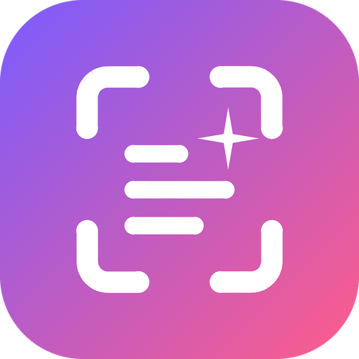
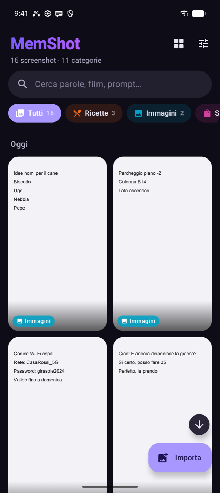
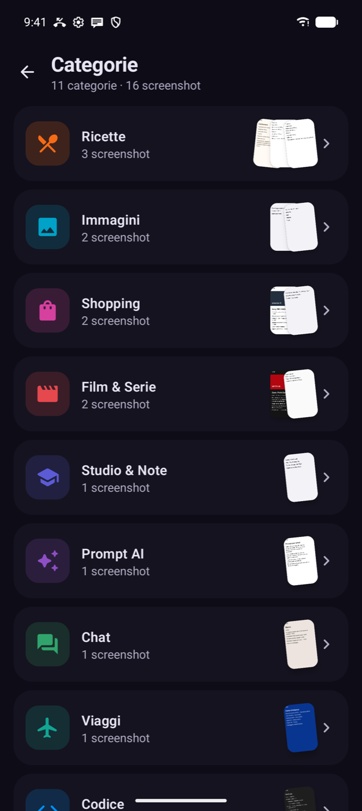
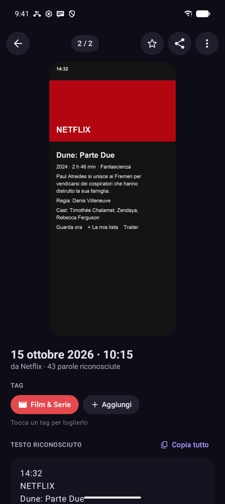
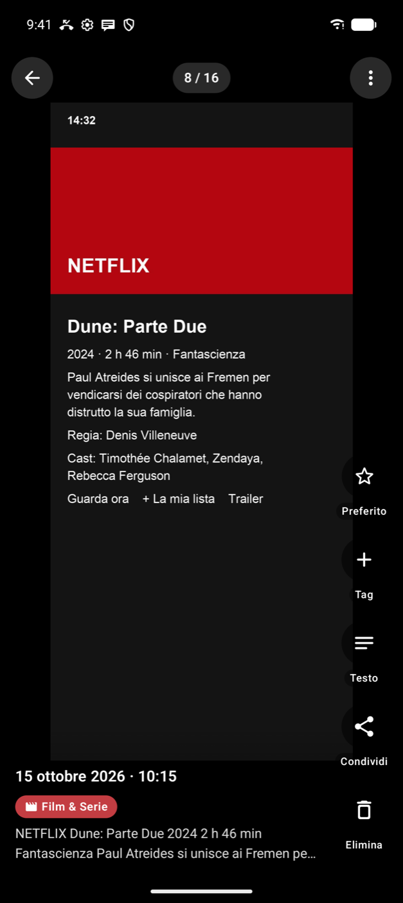

<div align="center">



# MemShot

### Tu fai gli screenshot. MemShot se li ricorda per te.

Ogni screenshot entra da solo nell'app, viene letto e finisce nella categoria giusta:
film, prompt per l'AI, ricette, chat, shopping e altre 17.
Quando ti serve, lo ritrovi cercando qualsiasi parola scritta dentro.

**Android 10 o successivo · Gratuita · Senza pubblicità · Senza account · Funziona offline**

[**Scarica l'ultima versione**](https://github.com/carellice/MemShot/releases/latest)

</div>

<p align="center">
  
  
  
  
</p>

---

## Cos'è

Chi fa tanti screenshot sa come va a finire: centinaia di immagini sparse in galleria e quella che ti serve non la trovi mai.
MemShot le raccoglie in un posto solo e le mette in ordine al posto tuo.

1. **Fai uno screenshot come sempre.** MemShot lo prende da solo, anche con l'app chiusa.
2. **Lo legge.** Riconosce il testo (OCR) e capisce cosa contiene.
3. **Lo cataloga.** Gli assegna fino a tre tag: un film va in *Film & Serie*, un prompt in *Prompt AI*, una ricetta in *Ricette*.
4. **Lo ritrovi.** Cerchi una parola qualsiasi, "carbonara", "Villeneuve", "gate B12", e lo screenshot salta fuori.

E la galleria resta pulita: dopo l'import l'originale viene spostato nel cestino del telefono (recuperabile per 30 giorni).

## Funzioni

| | |
|---|---|
| **Import automatico** | Ogni nuovo screenshot entra in MemShot da solo, con una notifica discreta che dice dove è finito. |
| **Condividi → Salva in MemShot** | Da qualsiasi app, senza nemmeno aprire MemShot. |
| **Riconoscimento del testo** | OCR sul telefono con Google ML Kit: niente viene caricato online. |
| **22 categorie automatiche** | Film & Serie, Prompt AI, Codice, Ricette, Shopping, Chat, Musica, Libri, Viaggi, Eventi, Finanza, Luoghi, Social, Notizie, Citazioni, Studio & Note, Lavoro & Email, Salute & Fitness, Sport, Giochi, Immagini, Altro. |
| **Ricerca in tutto il testo** | Trova parole dentro gli screenshot, ignorando maiuscole e accenti, ed evidenzia i risultati. |
| **Riordino di "Altro"** | Gli screenshot che l'app non sa collocare li sistemi tu, uno alla volta, con un tocco. MemShot impara dalle tue scelte. |
| **Galleria o stile TikTok** | Sfoglia gli screenshot in orizzontale oppure in verticale a tutto schermo; doppio tocco per i preferiti. |
| **Azioni rapide** | Link, email e numeri di telefono trovati nel testo diventano pulsanti. |
| **Tag personali e preferiti** | Aggiungi o togli tag, crea i tuoi, segna i preferiti. |
| **Backup** | Esporta tutto in un file `.zip` (Download, Google Drive…) e ripristinalo quando vuoi, senza doppioni. |
| **Aggiornamenti dall'app** | Dalle impostazioni controlla se c'è una nuova versione, la scarica e la installa. |

## Installazione

1. Apri la pagina dell'[ultima release](https://github.com/carellice/MemShot/releases/latest) dal telefono e scarica il file `.apk`.
2. Aprilo e consenti l'installazione da questa origine quando Android lo chiede.
3. Al primo avvio concedi l'accesso alle foto: serve per trovare i nuovi screenshot.

Per gli aggiornamenti successivi non serve tornare qui: vai in **Impostazioni** dentro l'app.

## Privacy

Tutto avviene sul telefono. L'OCR e la classificazione girano in locale, gli screenshot restano nella memoria privata
dell'app e nessun dato viene inviato a server esterni. L'app va in rete solo quando controlla gli aggiornamenti su GitHub.

---

## Per sviluppatori

Kotlin + Jetpack Compose (Material 3), Room, WorkManager, Coil, Google ML Kit (text recognition e image labeling, modelli inclusi).

| Cartella | Cosa contiene |
|---|---|
| `analysis/` | OCR, classificatore a punteggio (`Classifier.kt`) e categorie con parole chiave (`Categories.kt`) |
| `importer/` | Import da galleria, condivisione e selettore foto; rimozione degli originali (`PhoneCleaner.kt`) |
| `work/` | Job in background che si risveglia a ogni nuovo screenshot, analisi e notifiche |
| `data/` | Database Room, preferenze, backup `.zip` |
| `ui/` | Schermate Compose: home, categorie, dettaglio, riordino, onboarding |

Il classificatore combina parole chiave pesate (italiano e inglese), app di provenienza ricavata dal nome del file,
etichette visive di ML Kit ed euristiche dedicate (imperativi e segnaposto per i prompt, densità di simboli per il codice,
durate per i film, dosi per le ricette…). Per migliorare una categoria basta modificare `Categories.kt`; i test sono in `app/src/test`.

```bash
./gradlew :app:testDebugUnitTest   # test del classificatore
./gradlew :app:assembleRelease     # APK in app/build/outputs/apk/release/
```

**Pubblicare una nuova versione:** doppio clic su `Pubblica release.command`. Lo script alza la versione, compila l'APK,
salva le modifiche su GitHub, cancella le release precedenti e pubblica quella nuova. L'app la trova da sola dalle impostazioni.
